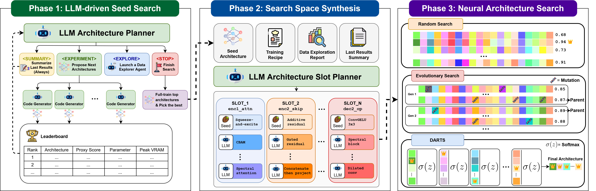

# Agentic Neural Architecture Search (NeurIPS 2026)

[](https://arxiv.org/abs/2607.07984)
[](https://neurips.cc/virtual/2026/loc/sydney/poster/154949)
[](LICENSE)

<p align="center">
  
</p>

AgentNAS is an agentic neural architecture search pipeline. LLM agents
explore your dataset, design and iteratively refine architectures, compile
the winner into a grammar of interchangeable slots, and evolve that search
space. The output is a trained, exportable PyTorch model. This repository
is the official implementation of the NeurIPS 2026 paper
[*"Agentic Neural Architecture Search"*](https://arxiv.org/abs/2607.07984).

## 🔥 Updates

- **[2026.09.25]** 🎉 AgentNAS is accepted to **NeurIPS 2026**!
- **[2026.07.08]** Paper released on [arXiv](https://arxiv.org/abs/2607.07984) and code released.

> **Reproducing the paper?** Use the frozen snapshot: `git checkout
> v1.0-reproducible` and follow the README at that tag. It documents the 17
> NAS-Bench-360 / NAS-Unseen benchmarks, data layout, per-task commands,
> and all ablations (the package and CLI there are named `autospace`).
> `main` is the actively developed, custom-dataset-first version.

## How it works
 
Every full run is a four-phase pipeline:
 
1. **Phase 1: LLM refinement.** A Planner ↔ Executor ↔ Explorer agent loop:
   the Explorer analyzes your data by executing code, the Planner proposes
   architectures, Executors turn them into runnable PyTorch, and each is
   proxy-trained on your GPUs.
2. **Phase 1.5: Modularize.** The winning architecture's repeated stages
   are refactored into per-stage modules (forward-equivalence validated).
3. **Phase 2: Search Space Synthesis.** A fresh-context LLM rewrites the winner as a
   slotted architecture: each slot gets several behaviorally distinct
   alternatives, defining a combinatorial search space.
4. **Phase 3: Evolution.** Regularized evolution over slot choices. The
   finalists are fully retrained, and the best-by-validation architecture
   across all phases is the reported winner (test data is never used for
   selection).
## Install
 
```bash
git clone https://github.com/alroimfebruary/AgentNAS && cd AgentNAS
conda create -n agentnas python=3.10 -y && conda activate agentnas
pip install torch torchvision torchaudio   # match your CUDA version
pip install -e ".[dev]"
 
# Anthropic API key: set the env var, or put a key file at the repo root
export ANTHROPIC_API_KEY="sk-ant-..."
# (alternative) echo "sk-ant-..." > anthropic_api_key.txt
```
 
## Quick start (five minutes on a toy dataset)
 
Runnable end-to-end without downloading anything (a dollar or two of LLM
budget with the default Sonnet driver, one GPU):
 
```bash
# 1. Generate a synthetic 4-class dataset
python examples/custom_task/make_toy_data.py --out ./toy_data
 
# 2. Validate the task definition (no LLM tokens spent)
agentnas validate-task examples/custom_task/toy_task.py --data-root ./toy_data
 
# 3. Search
agentnas run --task toy_task --phase 1 \
    --benchmark-file examples/custom_task/toy_task.py \
    --data-root ./toy_data --n-gpu 1 --budget 6
 
# 4. Inspect the winner and export its standalone model.py
agentnas results experiments/toy_task_phase1 --export best_model.py
```
 
## Bring your own dataset
 
Anything you can wrap in one Python file runs through the full pipeline.
The complete tutorial lives in
[`examples/custom_task/`](examples/custom_task/).
 
### 1. Define the task (one file)
 
**Convenience route.** Pre-split `.npy` classification needs only three
class attributes:
 
```python
from agentnas.benchmarks.registry import register_benchmark
from agentnas.benchmarks.simple import NpyClassificationBenchmark
 
 
@register_benchmark("my_task")
class MyTask(NpyClassificationBenchmark):
    task = "my_task"
    data_shape = (3, 32, 32)   # per-sample input shape
    n_classes = 10
```
 
with data at `<data-root>/my_task/{train,valid,test}_{x,y}.npy`. Loaders,
loss, metric, and Explorer test-set isolation come for free.
 
**Full-control route.** Subclass `BaseBenchmark` for custom formats, dense
outputs, or special metrics: implement the loaders, `loss_fn`,
`compute_metric`, shapes, and declare the visibility spec. See
[`examples/custom_task/full_custom_task.py`](examples/custom_task/full_custom_task.py).
 
**Agent route.** Let an LLM inspect the data and write the file for you,
iterating against the validator until it passes:
 
```bash
agentnas init-task --task my_task --data-root /path/to/data \
    --describe "ECG windows, 4 classes, npz per split, baseline F1 0.72"
```
 
The result is an ordinary benchmark file that you review and own.
 
### 2. Validate before spending budget
 
```bash
agentnas validate-task my_task.py --data-root /path/to/data
```
 
Checks the contract, runs the loader smoke test, verifies test-set
isolation and train/test disjointness, sanity-checks the metric, and
prints exactly what the LLM agents will see (file tree + README). Fix
every `[FAIL]` and eyeball the previews, since label semantics are yours
to verify.
 
### 3. Run
 
```bash
# Phase 1 only (LLM refinement):
agentnas run --task my_task --phase 1 --benchmark-file my_task.py \
    --data-root /path/to/data --n-gpu 4
 
# Full pipeline (Phase 1 → 1.5 → 2 → 3):
python scripts/run_production.py --task my_task \
    --benchmark-file my_task.py --data-root /path/to/data
```
 
The `--benchmark-file` registration is forwarded to every training worker
automatically. Runs checkpoint after every evaluation. Rerun the same
command to resume, add `--no-resume` to start fresh, or resume with a
larger `--budget` to extend a stopped search.
 
### The rules that keep results trustworthy
 
- **Metrics are lower = better.** This is a pipeline-wide invariant
  (report `1 - accuracy`, `1 - AUROC`, ...), and `validate-task` enforces it.
- **Declare `explorer_allowed_files`.** This is an allowlist of train/val files.
  Anything not listed (your test split) can never reach the LLM, and the
  pipeline refuses to run a task with no visibility spec.
- **`__init__` must not read data.** Metadata introspection has to work
  without the dataset present.
## Inspect results
 
```bash
agentnas results <experiment_dir>              # winner, per-phase metrics, tokens
agentnas results <experiment_dir> --export best_model.py
```
 
Winner selection follows the pipeline's ever-best-by-validation rule, and
`--export` writes the exact `model.py` that produced the reported test
metric, with a provenance header.
 
## Configuration
 
`configs/default.yaml` is the reference for every knob (budgets, patience,
timeouts, retries, VRAM gate, evolution parameters), each documented
inline. CLI flags override YAML values per run. The ones you'll actually
touch:
 
| Flag | Effect |
|---|---|
| `--task` / `--benchmark-file` / `--data-root` | What to search on |
| `--llm-model` | Anthropic or OpenAI model id |
| `--n-gpu N` | Parallel training workers (1 works fine) |
| `--budget N` | Total architecture evaluations |
| `--phase 1\|2\|3` | Single-phase run (`agentnas run`) |
| `--seed N` | Random seed (default 42) |
| `--search-mode {aggressive,evo,crossover,random,gdas}` | Phase 3 strategy |
| `--no-resume` | Force a fresh run |
 
## Built-in benchmarks
 
The 17 paper tasks remain registered on `main`: NAS-Bench-360 (cifar100,
spherical, ninapro, fsd50k, darcyflow, psicov, cosmic, ecg, satellite,
deepsea) and Unseen NAS (addnist, language, multnist, cifartile, gutenberg,
geoclassing, chesseract). They run with the same commands once their data
sits at the repo root (`agentnas smoke-test --task all` verifies the
loaders). Data sources, expected layout, per-task reproduction commands,
and the paper's ablations (blind mode, random search, GDAS, fixed-seed)
are documented at the `v1.0-reproducible` tag.
 
## Citation
 
If you find AgentNAS useful, please cite our paper:
 
```bibtex
@inproceedings{jeong2026agentnas,
  title     = {Agentic Neural Architecture Search},
  author    = {Jeong, Seokhoon and Kim, Mijung and Kim, Taehwan},
  booktitle = {Advances in Neural Information Processing Systems (NeurIPS)},
  year      = {2026}
}
```
 
## License
 
Released under the MIT License. See [LICENSE](LICENSE).
